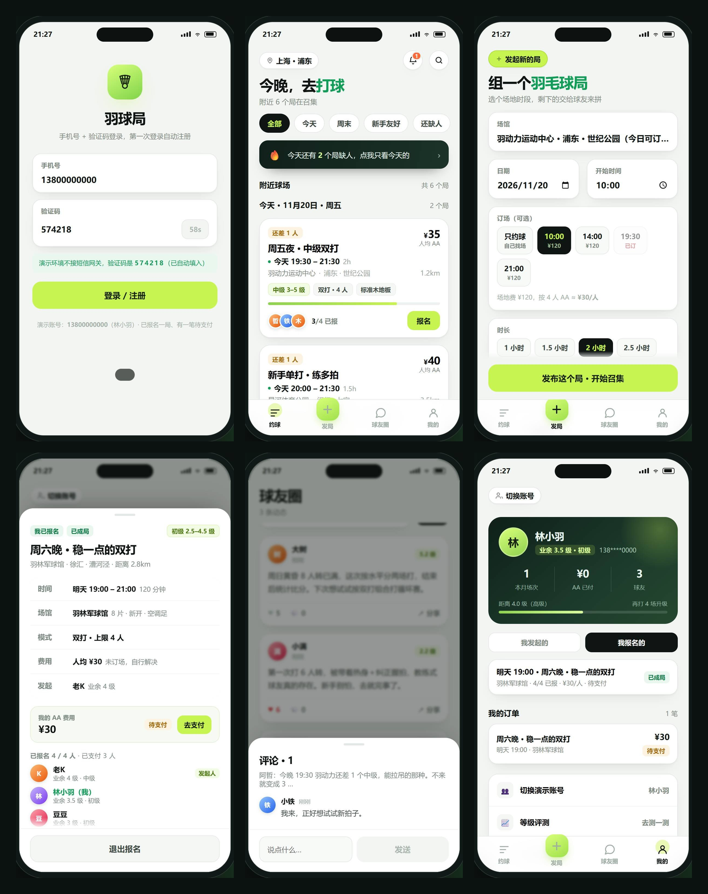

# 羽球局 · 约球 App（React + Express + Prisma + PostgreSQL）

[](https://github.com/CLY0317/yueqiu-app/actions/workflows/ci.yml)

一个「约球 / 拼场 / 球友圈」的羽毛球约局应用，交互参考闪动。
v2 把 v1 的本地演示版升级成了**有真实账号体系、能订场、能收钱、有通知**、数据落在 **PostgreSQL** 上的完整工程。



## v1 → v2 做了什么

| 能力 | v1 | v2 |
| --- | --- | --- |
| 登录 | 无（自动用演示账号） | 手机号 + 短信验证码（演示环境回显验证码）、JWT access(15min) + refresh(30d) 轮换 |
| 场地 | 只有一个场馆名字段 | 场馆时段库存，发局可**锁定场地**，解散自动释放 |
| 费用 | 只显示"人均 AA" | 报名即生成 AA 订单，可支付 / 退款，我的订单可查 |
| 球友圈 | 发动态、点赞 | 增加评论，作者收到站内通知 |
| 通知 | 无 | 报名 / 解散 / 评论 / 支付都会推一条，红点未读数 |
| 存储 | 手写 JSON 文件 | **Prisma + PostgreSQL**（迁移、关系、事务），可一键切回 SQLite |
| 测试 | 一个 node 冒烟脚本 | Vitest + supertest 23 个用例（含并发/退款/鉴权边界） |

## 技术栈

| 层 | 选型 |
| --- | --- |
| 前端 | React 18 + React Router 6 + Vite 6（手写 CSS，手机壳布局） |
| 后端 | Node.js + Express 4 + zod 校验 |
| 数据 | Prisma 6 + PostgreSQL 16（Docker）；SQLite 作为零安装备选 |
| 鉴权 | jsonwebtoken + 刷新令牌轮换（只存 sha256 摘要） |
| 测试 | Vitest + supertest（跑在独立的 yueqiu_test 库上） |

## 目录结构

```
yueqiu-app/
├── server/
│   ├── prisma/
│   │   ├── schema.prisma        # 12 张表：User/RefreshToken/SmsCode/Venue/CourtSlot/Game/...
│   │   ├── migrations/          # PostgreSQL 迁移
│   │   └── seed.mjs             # 演示数据（12 用户 / 4 场馆 / 112 时段 / 6 球局 / 订单）
│   └── src/
│       ├── index.js             # createApp()：路由装配 + 统一错误出口
│       ├── auth.js              # JWT、刷新令牌轮换、短信验证码、鉴权中间件
│       ├── db.js / env.js       # Prisma 单例、.env 加载
│       ├── dto.js               # 行 → 前端 DTO（myRole / myOrder / isFull…）
│       ├── notify.js            # 站内通知
│       └── routes/              # auth / venues / games / feed / me
├── web/src/                     # pages: Home Create Feed Mine Login GameSheet Notifications
├── scripts/                     # dev / test-db / smoke / db-provider
├── tests/api.test.js            # 23 个集成测试
└── docker-compose.yml           # PostgreSQL 16
```

## 快速开始

```bash
pnpm install

pnpm db:up        # docker compose up -d postgres（首次会拉镜像）
pnpm db:generate  # 生成 Prisma Client
pnpm db:migrate   # 应用迁移（建表）
pnpm db:reset     # 灌演示数据（会清空重来）

pnpm dev          # API :8787 + 前端 :5173
# 打开 http://127.0.0.1:5173
```

**演示账号**：手机号 `13800000000`（林小羽，已报名一局且有一笔 ¥30 待支付）。
登录页点「获取验证码」后，演示环境会把验证码直接回显并自动填入（`DEV_SMS=true`）。

生产构建：

```bash
pnpm build && pnpm start     # Express 单端口托管 dist + API，http://127.0.0.1:8787
```

## 关键设计

**登录**：`POST /auth/sms` 发码（60 秒冷却、5 分钟有效、5 次尝试上限）→ `POST /auth/login` 换 access + refresh。
refresh 每次使用都会**轮换并作废旧令牌**，重放旧 refresh 直接 401。access 过期时前端自动静默续期，失败才踢回登录页。

**订场**：`CourtSlot` 有 `(venueId, date, startTime)` 唯一约束和 `free | booked` 状态。
发局带 `slotId` 时在**同一个事务**里校验空闲、建局、占位；同一时段并发下单只会有一个成功（409 `SLOT_TAKEN`）。
解散球局把时段释放回 `free`。

**AA 订单**：报名成功即生成一条该用户的 `Order(unpaid)`；`POST /orders/:id/pay` 走模拟网关置 `paid`（真实项目换成创建支付单 + 回调）。
退出报名或球局被解散时，已付订单转 `refunded` 并记录 `refundedAt`，同时给相关人推通知。

**通知**：报名 → 通知发起人；解散 → 通知其他参与者；评论 → 通知作者；支付 → 通知自己。
红点未读数来自 `GET /notifications`，打开列表即标记已读。

**校验**：所有写接口先用 zod 校验，错误统一成 `{ error: { code, message, field } }`；Prisma 的 P2002/P2025 也映射成 409/404。

## API

| 方法 | 路径 | 鉴权 | 说明 |
| --- | --- | --- | --- |
| POST | `/api/auth/sms` | - | 发验证码（返回 `devCode`，仅 DEV_SMS） |
| POST | `/api/auth/login` | - | `{phone, code}` → `{accessToken, refreshToken, user}` |
| POST | `/api/auth/refresh` | - | 轮换刷新令牌 |
| POST | `/api/auth/logout` | - | 吊销 refresh |
| GET | `/api/auth/me` | ✓ | 当前用户 |
| GET | `/api/venues` | - | 场馆 + 今日可订时段数 |
| GET | `/api/venues/:id/slots?date=` | - | 某天时段（含已订） |
| GET | `/api/games?filter=&q=` | 可选 | 球局列表（all/today/weekend/newbie/need） |
| GET | `/api/games/:id` | 可选 | 详情（含 myRole / myOrder / paidCount） |
| POST | `/api/games` | ✓ | 发局，可带 `slotId` 锁场 |
| POST | `/api/games/:id/join` | ✓ | 报名（支持 `expectedVersion` 乐观锁） |
| POST | `/api/games/:id/leave` | ✓ | 退出（已付自动退款） |
| DELETE | `/api/games/:id` | ✓ | 解散（退款 + 释放场地） |
| GET/POST | `/api/feed` | 可选/✓ | 动态列表、发动态 |
| POST | `/api/feed/:id/like` | ✓ | 点赞切换 |
| GET/POST | `/api/posts/:id/comments` | 可选/✓ | 评论列表、发评论 |
| GET | `/api/me` | ✓ | 资料 + 场次/支出/球友/待支付 |
| GET | `/api/me/games?role=` | ✓ | 我发起的 / 我报名的 |
| GET | `/api/me/orders` | ✓ | 我的 AA 订单 |
| POST | `/api/orders/:id/pay` | ✓ | 发起支付（dev 直接置已付；wechat 返回 `codeUrl`） |
| POST | `/api/pay/wechat/notify` | 签名 | 微信支付回调（验签 + 解密 + 幂等） |
| GET | `/api/notifications` | ✓ | 通知 + 未读数 |
| POST | `/api/notifications/read` | ✓ | 标记已读 |

## 数据库

主路径是 **PostgreSQL 16**（容器 `yueqiu-pg`，端口 5432，库 `yueqiu`，测试库 `yueqiu_test`），
迁移在 `server/prisma/migrations/`，是 PG 专用的 SQL。

| 命令 | 作用 |
| --- | --- |
| `pnpm db:up` / `pnpm db:down` | 起 / 停 PostgreSQL 容器 |
| `pnpm db:migrate` | `prisma migrate dev` 应用迁移 |
| `pnpm db:pg:reset` | 重置 schema 并重放迁移 |
| `pnpm db:reset` | 清空并灌演示数据 |

**切回 SQLite**（不想开 Docker 时）：

```bash
node scripts/db-provider.mjs sqlite   # 改 provider + DATABASE_URL=file:./dev.db
pnpm db:generate && pnpm db:push && pnpm db:reset
```

注意 SQLite 走 `db push`（没有独立迁移集），且 `pnpm test` 目前固定连 PG 测试库。

## 测试

```bash
pnpm db:up    # 测试需要 PostgreSQL
pnpm test     # 重建 yueqiu_test → 23 个用例（接口级）
pnpm smoke    # 对着已经跑起来的服务体检 12 项
pnpm e2e      # Playwright 端到端（需要先 build + 起服务 + 灌种子）
```

端到端要跑在生产构建上：先 `pnpm db:reset`、`pnpm build`、`pnpm start`，另开一个终端 `pnpm e2e`。
首次需要装浏览器：`pnpm e2e:install`（Chromium + 系统依赖）。

6 个用例覆盖三条主线：

| 文件 | 用例 |
| --- | --- |
| `e2e/app.spec.js` | 登录、球局详情、「报名 → 生成 AA 订单 → 支付成功」付费闭环 |
| `e2e/flows.spec.js` | **发局**（填表单 + 订空闲时段 → 发布 → 大厅出现「我发起的」）、**评论**（发动态 → 评论 → 计数 +1）、**注销账号**（二次确认 → 删号 → 回到登录页）、**解散退款**（发起人解散 → 队友订单转「已退款」+ 收到解散通知） |

两个约定，改动前先读 `e2e/helpers.js`：

- **手机号每次运行都不同**。固定号码会被上一轮留下的状态污染（该账号已报名过、订单已付过），用例就不再可重复运行；撞上 60 秒短信冷却还会直接 429。号码必须正好 11 位——登录框有 `maxLength={11}`，多一位会被静默截断（序号位被砍掉，所有用例拿到同一个号）。
- **订场用例走 API 找空位**（`findFreeSlot`），不直接点 UI：发局表单默认选第一个场馆，反复跑测试会把它当天时段订满，那时 UI 上一个可选时段都没有。

覆盖：验证码冷却/过期/错误、登录与 refresh 轮换重放、时段查表、锁场、重复预订 409、报名并发（ALREADY_JOINED / VERSION_CONFLICT）、
支付与重复支付、退出退款、解散退款并释放场地、非发起人不能解散、动态与空内容校验、评论计数与通知、点赞幂等、通知已读、我的统计与订单。

## 持续集成（GitHub Actions）

`.github/workflows/ci.yml` 把上面这套验证搬到 GitHub，**不需要本机 Docker**：CI 里用 service container 直接起 `postgres:16-alpine`（与 `docker-compose.yml` 同镜像、同账号）。

| 作业 | 跑什么 |
| --- | --- |
| `test` | `pnpm install --frozen-lockfile` → `prisma generate` → `pnpm test`（脚本先 `migrate reset` 重建 `yueqiu_test`，再跑 23 个用例）→ `pnpm build` |
| `smoke` | 对主库 `prisma migrate deploy` → `pnpm db:reset` 灌种子 → 后台起 API 并轮询 `/api/health` → `pnpm smoke` 12 项（失败时打印 API 日志） |
| `e2e` | 迁移 + 种子 → `pnpm build` → 装 Chromium → 起 API → `pnpm e2e` 六个 Playwright 用例（登录 / 详情 / 付费闭环 / 发局 / 评论 / 解散退款） |

触发：任意分支 push、任意 PR、手动 `workflow_dispatch`；同一分支的新提交会取消上一次未完成的构建。

几个刻意的选择：

- **不用 `docker compose up`**：CI 里 service container 与本地 compose 是同一镜像同一套账号，但省掉了 compose 解析和健康轮询；`docker-compose.yml` 只服务本地开发。
- **pnpm store 显式指到 `~/.pnpm-store`**：仓库 `.npmrc` 的 `store-dir=.pnpm-store` 是给本机用的，CI 覆盖它，缓存才不会落进工作区。
- **`migrate deploy` 而不是 `migrate dev`**：CI 只应用已有迁移，不产生新迁移文件。
- **`DEV_SMS=true` 只在 CI**：测试和冒烟都要拿回显验证码；生产必须关掉。
- **两个作业都自带一份 PG service**：`smoke` 不依赖 `test` 留下的库状态，各自从空库开始。

不需要配置任何 Secret——数据库账号是每次构建里的一次性容器。

## 短信与支付渠道

两者都做成「环境变量切换的适配器」，默认 `dev`，所以本地和 CI 的行为与之前完全一样。

**短信**（`SMS_PROVIDER`）：

- `dev`：验证码打日志并随接口回显，前端自动填入。
- `aliyun`：阿里云 dysmsapi，RPC 风格签名（`GET&%2F&规范化参数串`，HMAC-SHA1）；需要 `ALIYUN_SMS_ACCESS_KEY_ID/SECRET`、`SIGN_NAME`、`TEMPLATE_CODE`。选了但没配齐会在构造渠道时就抛错，不会等到发短信才静默失败。

**支付**（`PAY_PROVIDER`）：

- `dev`：调用即置为已支付（模拟网关）。
- `wechat`：微信支付 APIv3 `Native` 下单，返回 `code_url` 给前端展示；订单状态由回调驱动——`POST /api/pay/wechat/notify` 用平台证书公钥验签（`RSA-SHA256`，待签串 `时间戳\n随机串\n原始报文\n`），再用 APIv3 密钥 `AES-256-GCM` 解密资源，最后按 `out_trade_no` 幂等置为已支付，金额不一致直接拒绝。

关于「沙箱」：微信支付 APIv3 **没有公开沙箱环境**（旧版 v2 沙箱已下线），只能用真实商户号做小额支付。所以这里的实现是「可对接真实商户的参数化适配」，验证分两层：签名与解密用 7 个纯函数单测覆盖（`tests/channels.test.js`），接口层走 dev 渠道。真正联调还需要：商户号、APIv3 密钥、平台证书，以及一个外部可达的 `PUBLIC_BASE_URL`。

## 上线前的安全基线

这一层是按「配错了就等于没有防护」的思路做的：**宁可起不来，也不静默降级**。

| 项 | 做法 |
| --- | --- |
| **验证码不回显** | dev 短信通道（会把验证码放进响应体）**默认关闭**，必须显式 `ALLOW_DEV_SMS=true` 才启用；`NODE_ENV=production` 下无论如何都禁止。真实渠道（阿里云）从不返回 `devCode` |
| **生产配置硬校验** | `NODE_ENV=production` 时启动即校验：JWT 密钥 ≥32 位且不是占位符、短信渠道不能是 dev、`CORS_ORIGINS` 非空、`DATABASE_URL` 存在。任一不满足直接退出并列出全部问题 |
| **限流** | 发码按手机号 5 条/小时 + 按 IP 100 条/小时；登录按 IP 60 次/15 分钟；全局接口 300 次/分钟。按 IP 的额度特意留得宽——同一 NAT 出口的同事不能被误伤，防爆破主要靠验证码自身的 5 次尝试上限 |
| **安全响应头** | `helmet` 提供 CSP / HSTS / X-Content-Type-Options / Referrer-Policy 等。CSP 放行 `style-src 'unsafe-inline'`（前端用了内联样式） |
| **CORS** | 只放行 `CORS_ORIGINS` 里列出的来源；生产未配置就一个都不放行 |
| **账号注销** | `DELETE /api/me`：删除个人数据、取消ta 主持的球局、给其他球友退款并通知。球局发起人改挂到「已注销用户」占位账号——`Game.host` 是必填关系，不转移就删不掉用户，转移而不是删局是为了保住其他人的订单与退款记录 |
| **日志脱敏** | 短信日志只记脱敏手机号与打码验证码，不再落全量 |
| **演示入口** | 硬编码演示手机号与「切换演示账号」面板受 `DEMO_MODE` 控制：只有 vite dev 或构建时显式 `VITE_DEMO_MODE=true` 才出现，生产构建默认消失 |

### 生产环境需要注入的变量

```bash
NODE_ENV=production
DATABASE_URL=postgresql://...            # 必填
JWT_SECRET=<≥32 位随机串>                 # 必填，不能用占位符
SMS_PROVIDER=aliyun                      # 必填，不能是 dev
ALIYUN_SMS_ACCESS_KEY_ID=...             # SMS_PROVIDER=aliyun 时必填
ALIYUN_SMS_ACCESS_KEY_SECRET=...
ALIYUN_SMS_SIGN_NAME=...                 # 需在阿里云完成签名与模板审核
ALIYUN_SMS_TEMPLATE_CODE=...
CORS_ORIGINS=https://你的域名            # 必填
ALLOW_DEV_SMS=false
DEV_SMS=false
# 支付接微信时还需要 WECHAT_* 一组与一个外部可达的 PUBLIC_BASE_URL
```

缺任何一项，进程会拒绝启动并打印具体缺什么。

## 没有做的（下一批）

- 真实商户/网关联调（支付回调、短信到达率）、支付对账与退款回执
- **HTTPS + 反向代理 + 域名 + ICP 备案**、部署与回滚流程
- **数据库定时备份与恢复演练**（目前只有一个 docker volume）
- **日志聚合与告警**（现在只有 console.log，无错误上报）
- **内容审核与举报入口**（球友圈是 UGC，现在没有任何过滤）
- 隐私政策与用户协议
- 地图/LBS 与按距离排序、图片上传、列表分页、WebSocket 推送
- 给 `Post` / `PostLike` 补索引（这两张表现还没有任何索引）

## 环境备注

- Node ≥ 20（开发用 Node 24）；包管理器用 **pnpm 11**（CI 里固定 `version: 11`）。
- `pnpm-workspace.yaml` 里设了 `nodeLinker: hoisted` 与 `allowBuilds`。注意 **pnpm 11 已改用 `allowBuilds`**（`包名: true` 的映射），旧的 `onlyBuiltDependencies` 会被静默忽略——而 pnpm 11 把"未批准的构建脚本"当作**硬错误**（`ERR_PNPM_IGNORED_BUILDS`，exit 1），所以 `prisma`/`@prisma/client`/`@prisma/engines`/`esbuild` 必须在白名单里，否则 `pnpm install` 直接失败。这张白名单是 `pnpm approve-builds <包名>` 写出来的，不要手改回旧键。
- `.env` 里的 `JWT_SECRET`、`DEV_SMS` 只能用于本地；上线前必须换成随机值并关掉 `DEV_SMS`。
- **如果 Docker Hub 拉不动**（国内常见），可以走镜像站再打回标准 tag：

```bash
docker pull docker.m.daocloud.io/library/postgres:16-alpine
docker tag docker.m.daocloud.io/library/postgres:16-alpine postgres:16-alpine
pnpm db:up
```

- 手机壳用 `overflow: clip` 而不是 `hidden`：`hidden` 仍可被「滚动到聚焦元素」带动整体位移，会让底部弹层错位。
- 本机已验证：PG 容器 healthy、迁移可重放、23 个用例在 PG 上全绿、`pnpm build` 通过。
